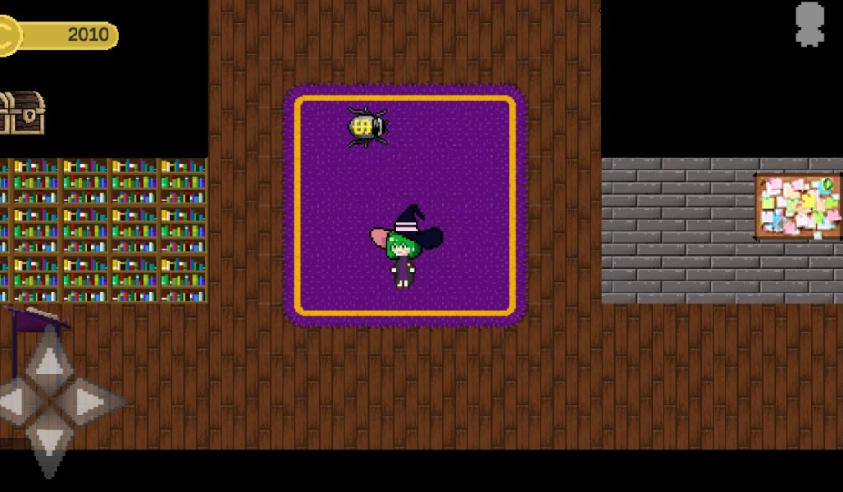
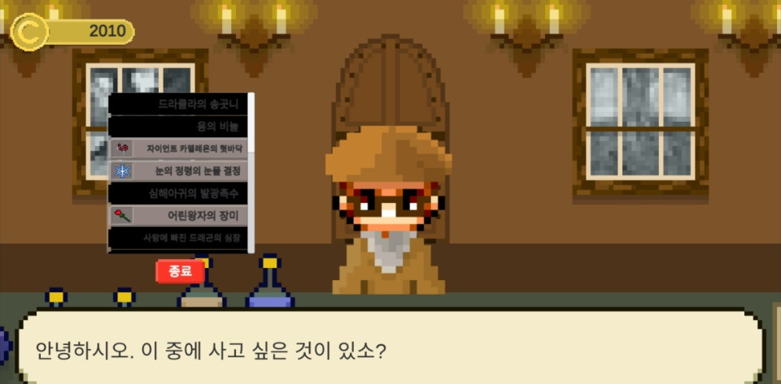
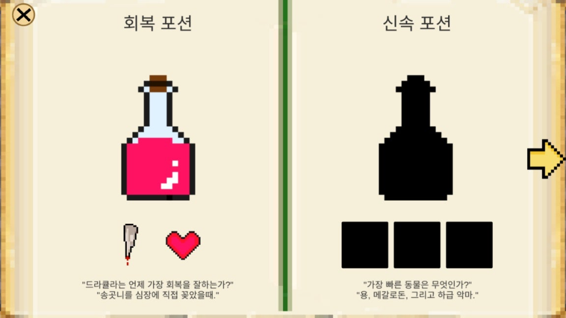
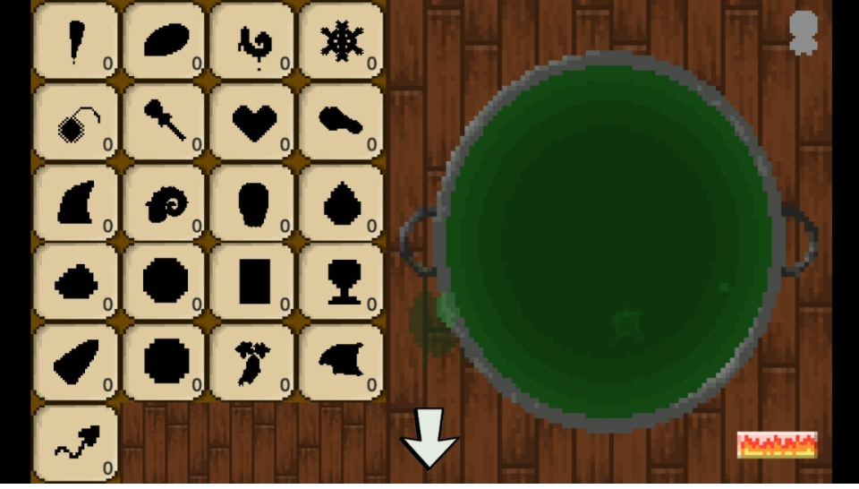

# 🧙‍♀️ 마녀의 포션가게

재료를 조합해 31종의 포션을 만들고, 상점을 찾아오는 손님에게 팔며 가게를 운영하는 2D 픽셀 아트 경영 게임입니다.

**1인 개발**: 기획, 프로그래밍, 픽셀 아트, UI를 모두 직접 만들었습니다.

| | |
|---|---|
| 엔진 | Unity 2020.3.12f1 |
| 언어 | C# |
| 플랫폼 | 모바일 (가로 화면, 가상 조이스틱) |
| 그래픽 | 픽셀 아트 직접 제작 |

<p align="center">
  
  
</p>
<p align="center">
  
  
</p>

## 게임 흐름


1. **가게:** 마녀를 움직여 돌아다니는 돈벌레를 잡아 돈을 모읍니다. 오른쪽 위에 사람 아이콘이 뜨면 손님이 온 것입니다.
2. **상점:** 재료 상인에게 재료를 사거나, 만든 포션을 팔거나, 특정 포션을 주문하는 손님의 의뢰를 해결합니다.
3. **가마솥:** 재료 21종 중 원하는 것을 넣고 조리 버튼을 누르면 포션이 만들어집니다. 처음 만든 포션은 획득 연출과 함께 레시피가 해금됩니다.
4. **레시피 북:** 해금한 레시피와, 아직 모르는 레시피의 힌트 문장을 볼 수 있습니다.

## 주요 구현

### 진행도에 따라 바뀌는 손님 구성
발견한 레시피 수(0~31)에 따라 손님이 등장할 확률을 선형으로 조정합니다.

| 손님 유형 | 시작 | 31종 모두 발견 |
|---|---|---|
| 재료 상인 | 60% | 20% |
| 주문 손님 | 1% | 20% |

초반에는 재료를 모아 실험하도록 유도하고, 레시피를 많이 알수록 주문을 해결하는 비중이 커지도록 난이도 곡선을 설계했습니다. (`Scripts/Next_Script.cs`)

### 막히지 않게 하는 장치
- **돈벌레 잡기:** 레시피 찾기에 계속 실패해 돈이 떨어져도, 가게를 돌아다니는 돈벌레를 잡아 다시 돈을 벌 수 있습니다. (`Scripts/bug.cs`)
- **다음 재료 요청:** 재료 상인이 떠날 때 다음에 가져왔으면 하는 재료 3가지를 고를 수 있습니다. 재료마다 원래 약 33% 확률로 판매되지만, 요청한 재료는 약 56%로 올라갑니다. (`Scripts/Next_Script.cs`)

### 실시간 손님 대기
- 손님은 30초가 지나면 붉게 변하고, 40초가 지나면 가게를 떠납니다.
- 손님이 떠난 뒤 20초가 지나면 2/3 확률로 다음 손님이 옵니다.
- 씬을 벗어날 때 대기 시간을 저장해, 가마솥이나 레시피 북을 다녀와도 손님 대기 상태가 이어집니다. (`Scripts/waiting.cs`)

### 씬 간 상태 저장
돈, 재료 21종, 포션 31종의 보유 수량과 레시피 해금 여부를 `PlayerPrefs`로 저장해, 가게·상점·가마솥·레시피 북 씬을 오가도 진행 상황이 이어집니다.

### 그 밖의 시스템
- 재료 상인의 가격 변동(±10)과 판매 수량 선택
- 가마솥 드래그 앤 드롭 조합 (`Scripts/ItemDrag.cs`, `Scripts/cauldron_backbutton.cs`)
- 돈벌레 랜덤 이동 AI (`Scripts/bug.cs`)
- 가상 조이스틱 이동 (`Scripts/UI/MoveCtrl.cs`)

## 폴더 구조

```
witch_potion_shop/Assets
├── Scenes/      Start(시작 화면) · scene2(가게) · store(상점) · cauldron(가마솥) · Recipe 1~15(레시피 북)
├── Scripts/     게임 로직
├── Animation/   캐릭터 · 획득 연출 애니메이션
├── Prefabs/
└── Resources/   픽셀 아트 리소스
```

## 실행 방법

1. Unity Hub에서 **Unity 2020.3.12f1**로 `witch_potion_shop` 폴더를 엽니다.
2. `Assets/Scenes/Start.unity`를 열고 Play를 누릅니다.

## 회고와 개선 계획

포션이 31종으로 늘어나면서 레시피 판정과 레시피 북 페이지를 코드와 씬에 직접 작성한 방식의 한계를 느꼈습니다. 포션 하나를 추가하려면 조합 판정 코드와 레시피 페이지 스크립트를 모두 고쳐야 했습니다.

다음 단계로 레시피·재료 데이터를 JSON(또는 ScriptableObject)으로 분리해, **코드를 고치지 않고 데이터 파일만 수정해 포션을 추가할 수 있는 구조**로 바꿀 계획입니다.
